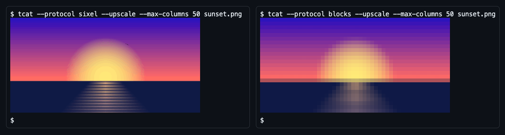

<p align="center">
  <a href="https://terminal-images.nullean.net">
    <picture>
      <source media="(prefers-color-scheme: light)" srcset="docs/images/brand/png/lockup-light.png">
      
    </picture>
  </a>
</p>

<p align="center">Show images in the terminal from .NET with the Kitty, iTerm2 and Sixel protocols, with protocol detection that does not hang and a half-block fallback. No dependencies, NativeAOT-safe.</p>

<p align="center">
  <a href="https://www.nuget.org/packages/Nullean.TerminalImages"></a>
  <a href="https://github.com/nullean/terminal-images/actions/workflows/ci.yml"></a>
  <a href="https://terminal-images.nullean.net"></a>
</p>



<sub>The bytes `tcat` (the example in `examples/`) wrote for `examples/sunset.png`, forced to Sixel and to half
blocks, played into [xterm.js](https://xtermjs.org) with its image addon, at a 10x20 pixel cell.</sub>

## Install

```sh
dotnet add package Nullean.TerminalImages
```

For a host, add its package instead: `Nullean.TerminalImages.Spectre`, `Nullean.TerminalImages.TerminalGui` or
`Nullean.TerminalImages.XenoAtom`.

## Quick start

```csharp
using Nullean.TerminalImages;
using Nullean.TerminalImages.Detection;

// Reads the environment, then asks the terminal once (macOS/Linux): Kitty, iTerm2, Sixel or half blocks?
var capabilities = await TerminalImageDetector.DetectAsync();

var renderer = new TerminalImageRenderer(capabilities, new TerminalImageRenderOptions { MaxColumns = 60, MaxRows = 20 });
if (!renderer.RenderPng(File.ReadAllBytes("sunset.png"), Console.Out))
	Console.WriteLine("(this terminal cannot show images)");
```

Or try it from a clone:

```sh
dotnet run --project examples/Nullean.TerminalImages.Cat -- --diagnostics               # what was detected, and why
dotnet run --project examples/Nullean.TerminalImages.Cat -- examples/sunset.png         # draw an image
dotnet run --project examples/Nullean.TerminalImages.Cat -- --protocol sixel examples/sunset.png
```

`tcat` reads PNG files only: the library has a PNG decoder, and no JPEG or GIF decoder.

- **Zero dependencies.** The core package has no `PackageReference`s: the PNG codec, resampler and all four encoders are
  managed code. No SkiaSharp, no ImageSharp, no native assets, so it publishes with NativeAOT (a 1.7 MB `tcat` binary
  on macOS arm64).
- **Detection that does not hang.** It reads the environment first, then asks the terminal once with a batch of queries that always
  ends with a Device Attributes request, which every terminal answers. The wait ends when the terminal has said everything it will say.
- **Hosts, not just a library.** Integrations for Spectre.Console, Terminal.Gui v2 and XenoAtom.Terminal.
- **An override when detection is wrong.** `tcat --diagnostics` shows what was detected and why, and
  `NULLEAN_TERMINAL_IMAGES=kitty|iterm2|sixel|blocks|none` overrides it without code.

## Packages

| Package | What it is | |
|---|---|---|
| [`Nullean.TerminalImages`](src/Nullean.TerminalImages/README.md) | The core: image model, PNG codec, resampler, encoders, detection, renderer. No package dependencies. | [](https://www.nuget.org/packages/Nullean.TerminalImages) |
| [`Nullean.TerminalImages.Spectre`](src/Nullean.TerminalImages.Spectre/README.md) | A `TerminalImage` renderable for Spectre.Console | [](https://www.nuget.org/packages/Nullean.TerminalImages.Spectre) |
| [`Nullean.TerminalImages.TerminalGui`](src/Nullean.TerminalImages.TerminalGui/README.md) | A `TerminalImageView` for Terminal.Gui v2, and detection that feeds Terminal.Gui's own pipeline | [](https://www.nuget.org/packages/Nullean.TerminalImages.TerminalGui) |
| [`Nullean.TerminalImages.XenoAtom`](src/Nullean.TerminalImages.XenoAtom/README.md) | `WriteImage` for XenoAtom.Terminal (no SkiaSharp) | [](https://www.nuget.org/packages/Nullean.TerminalImages.XenoAtom) |

## Status

An early release. What has been verified, and how:

| Verified | How |
|---|---|
| Encoders, PNG codec, resampler, detection logic, renderer | Unit tests, with mutation checks: each rule was broken on purpose to confirm a test fails |
| Probing a terminal (raw mode, timeout, restoring the terminal) | The published NativeAOT binary run in a pseudo-terminal with a scripted terminal, on macOS and on Linux (in CI) |
| Terminal.Gui view | A live Terminal.Gui application with its ANSI driver, in tests |
| XenoAtom | Its in-memory backend |
| NativeAOT | Published with warnings as errors on macOS arm64, and in CI on Linux, macOS and Windows, where the published binary also runs |

**Not yet verified:** output on real terminals (Kitty, Ghostty, iTerm2, WezTerm, foot, Windows Terminal, xterm), and tmux or SSH. The terminal-specific choices in
[`TerminalBrands`](src/Nullean.TerminalImages/Detection/TerminalBrands.cs) come from how other terminal image tools and the
terminals' documentation treat them.

## Learn more

- Documentation: https://terminal-images.nullean.net
  ([getting started](https://terminal-images.nullean.net/getting-started/),
  [detection](https://terminal-images.nullean.net/detection/),
  [the protocols](https://terminal-images.nullean.net/protocols/),
  [integrations](https://terminal-images.nullean.net/integrations/),
  [troubleshooting](https://terminal-images.nullean.net/troubleshooting/))
- [DECISIONS.md](DECISIONS.md): why it is built the way it is
- [Releases](https://github.com/nullean/terminal-images/releases)
- [Contributing](https://github.com/nullean/.github/blob/main/CONTRIBUTING.md)

MIT licensed. Copyright Nullean and contributors.
