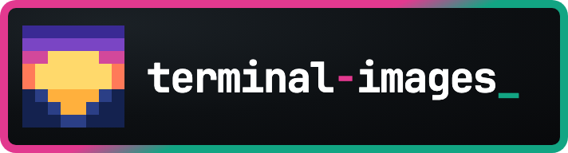

# Nullean.TerminalImages.Spectre



Show images in Spectre.Console with the Kitty, iTerm2 or Sixel protocol, falling back to half blocks drawn with Spectre's own colours. `TerminalImage` is a Spectre renderable: write it like any other widget.

[](https://www.nuget.org/packages/Nullean.TerminalImages.Spectre)

## Install

```sh
dotnet add package Nullean.TerminalImages.Spectre
```

## Quick start

```csharp
using Nullean.TerminalImages.Detection;
using Nullean.TerminalImages.Spectre;
using Spectre.Console;

// Optional: probe once at start-up. Without this, images use environment-only detection.
TerminalImage.DefaultCapabilities = await TerminalImageDetector.DetectAsync();

var image = TerminalImage.FromPng(File.ReadAllBytes("chart.png"));
image.MaxWidth = 40;          // cells; never wider than Spectre offers
image.AltText = "[chart]";    // written when the console has no ANSI or no image support
AnsiConsole.Write(image);
```

- It sizes itself to the width Spectre offers; `MaxWidth`, `MaxHeight` and `Resample` (`ResampleMode.Nearest` for
  pixel art) tune it per image.
- Inside a `Panel` or `Table`, Spectre pads lines with spaces that overwrite Sixel and iTerm2 images; only Kitty
  survives. Put images directly on the console, or accept half blocks there.
- `DefaultCapabilities` is static and cached; set `Capabilities` on one image to override it for that image.
- Probe before a `Live` display or prompt starts reading input.

## Learn more

- Documentation: https://terminal-images.nullean.net
- Integrations: https://terminal-images.nullean.net/integrations/
- Source and issues: https://github.com/nullean/terminal-images
