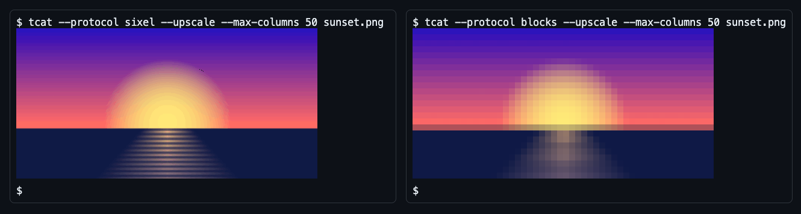

# Nullean.TerminalImages


Show images in the terminal with the Kitty, iTerm2 and Sixel protocols, with protocol detection and a half-block fallback. No dependencies, NativeAOT-safe.

[](https://www.nuget.org/packages/Nullean.TerminalImages)

## Install

```sh
dotnet add package Nullean.TerminalImages
```

## Quick start

```csharp
using Nullean.TerminalImages;
using Nullean.TerminalImages.Detection;

// Reads the environment, then asks the terminal once (macOS/Linux): Kitty, iTerm2, Sixel or half blocks?
var capabilities = await TerminalImageDetector.DetectAsync();

var renderer = new TerminalImageRenderer(capabilities, new TerminalImageRenderOptions { MaxColumns = 60, MaxRows = 20 });
if (!renderer.RenderPng(File.ReadAllBytes("sunset.png"), Console.Out))
	Console.WriteLine("(this terminal cannot show images)");
```



- **Zero dependencies.** The PNG codec, resampler and all four encoders are managed code: no SkiaSharp, no
  ImageSharp, no native assets.
- **Detection that does not hang.** It reads the environment first, then asks the terminal once with a batch of
  queries that always ends with a Device Attributes request, which every terminal answers.
- Only PNG is decoded; for other formats build an `RgbaImage` from RGBA bytes yourself.
- Redirected output detects as `None` and nothing is written; force a protocol with
  `TerminalImageDetectionOptions.Protocol` to write escape sequences into a file anyway.
- `NULLEAN_TERMINAL_IMAGES=kitty|iterm2|sixel|blocks|none|auto` overrides detection without code, and
  `capabilities.Diagnostics` says why detection chose what it did.
- Detection sees through tmux and wraps output in its passthrough; tmux itself must have `allow-passthrough on`.
- For Spectre.Console, Terminal.Gui or XenoAtom.Terminal use the `Nullean.TerminalImages.<Host>` package.

## Learn more

- Documentation: https://terminal-images.nullean.net
- Detection: https://terminal-images.nullean.net/detection/
- The protocols: https://terminal-images.nullean.net/protocols/
- Troubleshooting: https://terminal-images.nullean.net/troubleshooting/
- Source and issues: https://github.com/nullean/terminal-images
